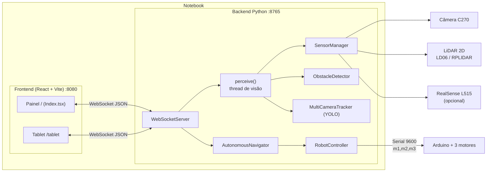
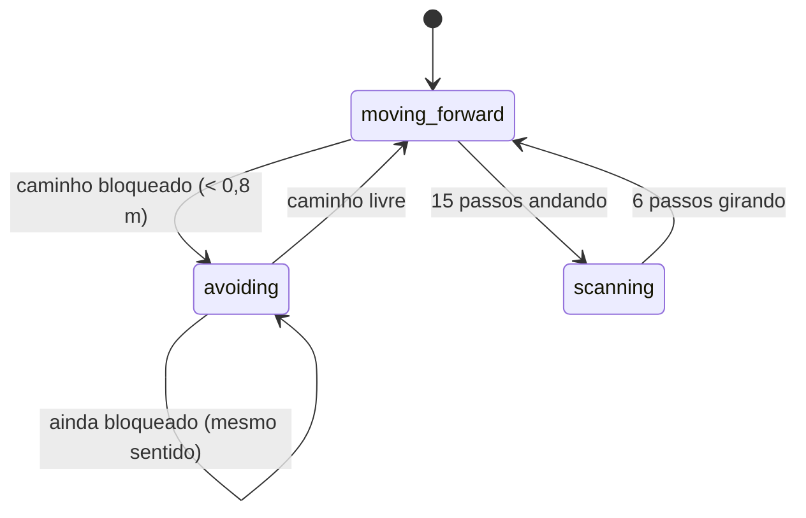

# RAS 2.0 — Documentação Completa

Este documento explica como o RAS 2.0 funciona: o que mudou em relação à versão anterior, como rodar,
como cada parte do sistema se comunica e como testar tudo sem o robô.

Para começar rápido, veja o [README](README.md). Aqui está o "por dentro".

---

## Sumário

1. [O que mudou da versão anterior](#1-o-que-mudou-da-versão-anterior)
2. [Visão geral da arquitetura](#2-visão-geral-da-arquitetura)
3. [Como rodar](#3-como-rodar)
4. [Estrutura de pastas](#4-estrutura-de-pastas)
5. [Backend em detalhe](#5-backend-em-detalhe)
6. [Sensores](#6-sensores)
7. [Navegação autônoma](#7-navegação-autônoma)
8. [Simulador](#8-simulador)
9. [Frontend](#9-frontend)
10. [Protocolo WebSocket (mensagens)](#10-protocolo-websocket-mensagens)
11. [Arduino e cinemática](#11-arduino-e-cinemática)
12. [Testes](#12-testes)
13. [Colocando no robô real (checklist)](#13-colocando-no-robô-real-checklist)
14. [Solução de problemas](#14-solução-de-problemas)
15. [Próximos passos sugeridos](#15-próximos-passos-sugeridos)

---

## 1. O que mudou da versão anterior

### Antes (RAS 1.x)

- O backend rodava no notebook: `source ~/L515/bin/activate`, `cd librealsense/build/wrappers/python`, `python3 robto_autonomous_control.py`.
- O frontend era acessado pelo preview do **Lovable** (na nuvem).
- O repositório no GitHub tinha só parte do frontend (`src/components` e `src/pages`); o projeto completo estava apenas numa pasta local.
- Sensores: Intel RealSense **L515** e **D435**.
- Não havia como testar sem o robô.

### Agora (RAS 2.0)

| Tema | Mudança |
|------|---------|
| Execução | Um único comando (`./start.sh`) sobe backend + frontend no próprio notebook |
| Lovable | Não é mais necessário; o frontend completo está em `frontend/` |
| Sensores | **Logitech C270** (câmera RGB) + **LiDAR 2D** (LD06/LD19 ou RPLIDAR). A **L515** continua suportada enquanto estiver no robô |
| Sem robô | Modo `--sim`: robô, Arduino, câmera e LiDAR simulados |
| Testes | `./test.sh` com 29 testes automáticos do backend + checagem/build do frontend |
| Pasta da librealsense | Não é mais preciso rodar de dentro dela; o backend carrega a biblioteca sozinho |

### Bugs corrigidos

| Problema | O que acontecia | Correção |
|----------|-----------------|----------|
| Status da navegação | Backend mandava `navigation`, frontend lia `navigation_status` → o painel nunca mostrava nada | Backend manda os dois, no formato que o `AutonomousControl` espera |
| Botão "Desconectar" | Frontend mandava `disconnect_serial`, backend não tratava | Implementado (também para os motores) |
| Desligar o modo autônomo | O robô continuava com o último comando (o Arduino mantém o último valor) | Ao desligar, o backend manda parar |
| Obstáculo bem à frente | O navegador só comparava esquerda × direita; um obstáculo no centro podia passar despercebido | Agora olha o **corredor à frente** do robô |
| Oscilação perto de paredes | O robô ficava alternando "gira esquerda / gira direita" sem sair do lugar | Mantém o mesmo sentido de giro até o caminho abrir |
| Câmeras no modo básico | `RealSenseController.start()` nunca era chamado; as câmeras só ligavam com o YOLO | Sensores iniciam junto com o backend |
| `DirectionalControl.tsx` no GitHub | Arquivo vazio (1 byte) | Restaurado da cópia local |
| Lista de portas | Só aparecia após clicar em "atualizar" | Backend envia a lista assim que o navegador conecta |
| Mensagem inválida | Um JSON inválido derrubava a conexão | Ignorada com aviso no terminal |
| Interface fechada | Se o navegador fechasse, o robô continuava andando | Quando o último cliente desconecta, o robô para |
| Formato dos objetos | Tracker básico mandava `bbox` como tupla e o frontend esperava `{x,y,w,h}` | Unificado no formato do YOLO |

---

## 2. Visão geral da arquitetura



O ciclo principal roda **10 vezes por segundo**:

1. A thread de percepção lê a câmera, a L515 (se houver) e a última volta do LiDAR.
2. Calcula os obstáculos (setores esquerda/centro/direita e o corredor à frente).
3. Se o YOLO estiver ligado, detecta objetos e mede a distância deles.
4. Se o modo autônomo estiver ligado, o navegador decide o movimento e o `RobotController` manda para o Arduino.
5. Tudo é enviado ao navegador numa mensagem `sensor_data`.

Os comandos manuais (botões, WASD) vão do navegador para o backend e direto para o Arduino, sem esperar o ciclo. Comandos de voz (navegador ou José) viram um movimento curto com parada automática.

No **modo `--sim`**, as caixas da direita (câmera, LiDAR, Arduino) são substituídas por versões simuladas
que leem e alteram um mundo virtual. O resto do código é **exatamente o mesmo** do robô real.

---

## 3. Como rodar

### Comandos principais

```bash
cd ~/ras-2.0

./start.sh            # robô real (detecta C270, LiDAR e L515 sozinho)
./start.sh --sim      # sem o robô: tudo simulado
./test.sh             # roda os testes internos
./start.sh --help     # todas as opções
```

O navegador abre em **http://localhost:8080**. `Ctrl+C` no terminal encerra backend e frontend; antes de sair
o backend manda `0,0,0` para os motores.

Na primeira execução, o `start.sh` roda `npm ci` para instalar as dependências do frontend.

### Opções do `start.sh`

As opções `--lan`, `--no-browser` e `--help` são do próprio script; **todas as outras** são repassadas ao backend.

| Opção | Padrão | Descrição |
|-------|--------|-----------|
| `--sim` | — | Simula robô, Arduino, câmera e LiDAR. A porta `SIM` já vem conectada |
| `--no-auto-connect` | — | No `--sim`, não conecta o Arduino simulado sozinho (para testar o fluxo de conexão) |
| `--lan` | — | Libera acesso por outros aparelhos na rede (tablet) |
| `--no-browser` | — | Não abre o navegador |
| `--voz` | — | Também sobe o assistente de voz José; o rosto abre em **http://localhost:8090** (veja `voz/README.md`) |
| `--host` | `127.0.0.1` | Endereço do WebSocket (o `--lan` usa `0.0.0.0`) |
| `--port` | `8765` | Porta do WebSocket |
| `--camera` | `auto` | `auto`, `usb` ou `none` |
| `--camera-device` | procura a C270 | Ex.: `/dev/video2` ou `2` |
| `--camera-fov` | `60` | Campo de visão horizontal da câmera, em graus (C270 ≈ 60°) |
| `--l515` | `auto` | `auto` (usa se estiver conectada), `on`, `off` |
| `--lidar` | `auto` | `auto`, `ld06`, `rplidar`, `rplidar-c1`, `none` |
| `--lidar-port` | detecta | Ex.: `/dev/ttyUSB1` |
| `--lidar-baud` | do modelo | Força outra velocidade serial |
| `--lidar-offset` | `0` | Graus para alinhar o 0° do LiDAR com a frente do robô |
| `--lidar-flip` | — | LiDAR montado de cabeça para baixo |

### Variáveis de ambiente

| Variável | Padrão | Para quê |
|----------|--------|----------|
| `RAS_VENV` | `~/L515` | Venv do Python usado pelo `start.sh` e `test.sh` |
| `RAS_REALSENSE_DIR` | `~/librealsense/build/wrappers/python` | Onde está a build 2.54 do `pyrealsense2` (para a L515) |
| `VITE_WS_URL` | mesmo host da página, porta 8765 | Força outro endereço do backend no frontend |

### Acessando pelo tablet

```bash
./start.sh --lan
```

No tablet (mesma rede Wi-Fi), abra `http://<ip-do-notebook>:8080/tablet`. Para descobrir o IP: `hostname -I`.

> Sem `--lan`, o backend só aceita conexões do próprio notebook. Isso é proposital: com `--lan`,
> qualquer pessoa na mesma rede consegue controlar o robô.

### Rodando as partes separadamente (opcional)

```bash
# Terminal 1 - backend
source ~/L515/bin/activate
cd ~/ras-2.0/backend
python3 robot_autonomous_control.py --sim

# Terminal 2 - frontend
cd ~/ras-2.0/frontend
npm run dev
```

---

## 4. Estrutura de pastas

```
ras-2.0/
├── start.sh                    # sobe backend + frontend
├── test.sh                     # testes internos
├── README.md                   # guia rápido
├── COMO_RODAR.md               # passo a passo para ligar o robô
├── DOCUMENTACAO.md             # este arquivo
├── arduino/
│   └── arduino_robot_control.ino
├── voz/                        # assistente de voz José (veja voz/README.md)
│   ├── jose.py                       # escuta, transcreve (faster-whisper), manda comandos ao backend e serve o rosto (8090)
│   ├── web/index.html                # página do rosto
│   ├── rostojose/                    # rostos do José
│   ├── historinhas/                  # histórias .mp3 (fora do git)
│   └── requirements.txt
├── backend/
│   ├── robot_autonomous_control.py   # servidor, obstáculos, navegação, Arduino
│   ├── sensors.py                    # C270, L515, LD06, RPLIDAR
│   ├── simulator.py                  # mundo simulado e sensores falsos
│   ├── robot_tracking_system.py      # YOLO + Kalman
│   ├── requirements.txt
│   ├── yolov8n.pt                    # modelo YOLO (fora do git; baixado sozinho se faltar)
│   └── tests/
│       ├── test_lidar_protocols.py
│       ├── test_navigation.py
│       ├── test_server.py
│       └── test_yolo.py
└── frontend/
    ├── package.json, vite.config.ts, tailwind.config.ts, ...
    └── src/
        ├── pages/Index.tsx           # painel principal
        ├── pages/TabletStatus.tsx    # carinha do tablet
        ├── lib/ws.ts                 # endereço do backend
        ├── lib/voiceCommands.ts      # vocabulário de voz (o mesmo do José)
        └── components/
            ├── StatusBar.tsx         # barra fixa: status dos sensores + PARAR
            ├── Lidar2DView.tsx       # mapa de pontos do LiDAR 2D (com tela de espera)
            ├── CameraPanel.tsx       # câmera + caixas do YOLO (+ L515 se houver)
            ├── ObstaclePanel.tsx     # distâncias por setor (chão e altura)
            ├── AutonomousControl.tsx
            ├── DirectionalControl.tsx
            ├── MotorSpeedControl.tsx
            ├── SerialConnectionControl.tsx
            ├── VoiceControl.tsx
            └── ui/                   # componentes shadcn
```

---

## 5. Backend em detalhe

Arquivo principal: `backend/robot_autonomous_control.py`.

### Classes

| Classe / função | Responsabilidade |
|-----------------|------------------|
| `SensorManager` | Guarda a câmera principal, a L515 e o LiDAR; inicia, lê e para todos. Se um sensor falha ao iniciar, é descartado e o sistema segue sem ele |
| `ObstacleDetector` | `analyze_scan()` para o LiDAR 2D e `analyze_height()` para a profundidade da L515 |
| `merge_obstacles()` | Junta os obstáculos de vários sensores, ficando com a menor distância de cada setor |
| `ObjectTracker` | Tracker "básico" por profundidade (só com a L515), código original |
| `AutonomousNavigator` | Máquina de estados da navegação (seção 7) |
| `RobotController` | Conexão serial com o Arduino (ou o Arduino simulado), comandos de movimento |
| `WebSocketServer` | Recebe comandos do navegador, roda o ciclo de sensores e envia `sensor_data` |
| `build_system()` | Monta tudo a partir das opções de linha de comando |

### Threads e desempenho

- O WebSocket roda num loop `asyncio`.
- A leitura de câmeras + YOLO roda numa **thread separada** (`ThreadPoolExecutor` de 1 thread), para que comandos
  manuais continuem respondendo mesmo quando o YOLO está processando.
- O LiDAR lê a serial numa thread própria e guarda só a última volta completa.
- O modelo YOLO só é carregado na primeira vez que o switch "YOLO Tracking" é ligado (demora alguns segundos).

### Segurança

- Ao desligar o modo autônomo → `stop`.
- Ao desconectar o Arduino → `0,0,0` antes de fechar a porta.
- Quando **todos** os navegadores fecham → modo autônomo desligado e `stop`.
- Ao encerrar o backend (`Ctrl+C` ou `SIGTERM`) → `stop`.
- Valores de motor sempre limitados a `-255..255` antes de enviar.
- A porta do LiDAR é removida da lista de portas do Arduino, para não ser escolhida por engano.

> Observação: no controle manual, o frontend manda **um** comando ao pressionar a tecla; o Arduino mantém esse
> comando até receber outro (como já era antes). O "robot_moving" do tablet volta para "Parado" 0,3 s após o
> último comando, mesmo que as rodas ainda estejam girando. Esse comportamento é da versão anterior e foi mantido.

---

## 6. Sensores

Arquivo: `backend/sensors.py`.

### Convenção de ângulos

Todos os dados do LiDAR são convertidos para o **referencial do robô**:

```
            0° (frente)
               ▲
   +90°  ◄─── robô ───►  -90°
 (esquerda)          (direita)
               ▼
            ±180° (trás)
```

Os LiDARs medem no sentido **horário**; a conversão inverte o sentido, aplica `--lidar-offset` e, se pedido,
`--lidar-flip`. As distâncias vão em metros; `0` significa "sem leitura".

### Câmera C270 (`UsbCamera`)

- Usa OpenCV com V4L2, 640×480, MJPG, buffer de 1 frame (menos atraso).
- Detecção automática: procura em `/sys/class/video4linux` pelo ID USB da C270 (`046d:0825`) ou pelo nome "C270".
  Se não achar, usa a primeira webcam disponível (por exemplo, a do notebook).
- Câmeras RealSense que aparecem como webcam são ignoradas (elas são tratadas pela classe da L515).
- Não tem profundidade: a distância dos objetos vem do LiDAR (seção 6.5).

### RealSense L515 (`RealSenseCamera`)

- O suporte à L515 foi **removido na librealsense 2.55+**. O `pyrealsense2` instalado pelo pip no venv é 2.56 e
  **não enxerga** a L515 — era por isso que o script antigo precisava rodar de dentro de
  `librealsense/build/wrappers/python` (onde está a build 2.54).
- Agora `load_pyrealsense2()` carrega diretamente o arquivo
  `~/librealsense/build/wrappers/python/pyrealsense2.cpython-310-x86_64-linux-gnu.so`. Se não existir, usa o do pip.
- Tenta os perfis 640×480 / 320×240 de profundidade, alinhada à imagem colorida, e converte a profundidade para metros.
- Se a C270 também estiver presente, a C270 vira a câmera principal e a L515 aparece num card separado.

### LiDAR 2D

Dois drivers, escritos direto em `pyserial` (sem dependências novas):

| Modelo | Classe | Serial | Funcionamento |
|--------|--------|--------|---------------|
| LDROBOT **LD06 / LD19** | `LD06Lidar` | 230400 baud | O sensor transmite sozinho. Pacotes de 47 bytes (cabeçalho `0x54 0x2C`, 12 pontos, CRC-8) |
| Slamtec **RPLIDAR A1/A2** | `RPLidar` | 115200 baud | Comando `SCAN` (`A5 20`), amostras de 5 bytes. O motor do A1 liga com DTR baixo |
| Slamtec **RPLIDAR C1** | `RPLidar` | 460800 baud | Mesmo protocolo (`--lidar rplidar-c1`) |

**Detecção automática** (`--lidar auto`): percorre as portas seriais (ignora `ttyACM*`, típicas de Arduino, e `ttyS*`):

1. Abre a 230400 e só **escuta**: se aparecer um pacote LD06 válido (com CRC correto) → LD06.
2. Senão, manda `GET_HEALTH` a 115200 e depois a 460800: se responder `A5 5A` → RPLIDAR.

Se a detecção atrapalhar (por exemplo, abrir a porta do Arduino), passe o modelo e a porta explicitamente:
`./start.sh --lidar ld06 --lidar-port /dev/ttyUSB1`.

### YOLO com C270 + LiDAR

Arquivo: `backend/robot_tracking_system.py`.

- Modelo `yolov8n.pt`, detecção a cada 3 frames, filtro de Kalman suavizando a posição de cada objeto entre detecções.
- **Distância de cada objeto:**
  - com L515: mediana da profundidade numa janela no centro da caixa;
  - com C270: calcula o **ângulo** do centro da caixa na imagem (usando o campo de visão de 60°) e pega a menor
    leitura do LiDAR em ±3° desse ângulo.
- Os objetos viram obstáculos por setor (`_convert_tracking_to_obstacles`) e entram na navegação junto com o LiDAR.

> Para a fusão funcionar bem, a câmera e o LiDAR devem estar alinhados (ambos apontando para a frente do robô)
> e o 0° do LiDAR deve coincidir com a frente (ajuste com `--lidar-offset`).

---

## 7. Navegação autônoma

### Leitura de obstáculos do LiDAR

`ObstacleDetector.analyze_scan()` produz:

- **Setores** (para a interface e para escolher o lado do giro):

  | Setor | Ângulos |
  |-------|---------|
  | esquerda | 20° a 70° |
  | centro | -20° a 20° |
  | direita | -70° a -20° |

  Cada setor tem a menor distância e a flag "bloqueado" (< 0,5 m).

- **`path_distance`** (o que decide se dá para andar): distância até o primeiro ponto dentro do **corredor**
  à frente do robô, com meia largura de 0,3 m (raio do robô ≈ 0,2 m + margem).

```
        corredor (0,6 m)
        |<-------->|
        |    •     |   ← este ponto bloqueia (está no corredor)
   •    |          |   ← este não bloqueia (está fora)
        |          |
        |  [robô]  |
```

Por que o corredor? Com setores largos, uma parede **ao lado** do robô (que não atrapalha andar para frente)
aparecia nos setores esquerda/direita e fazia o robô travar girando. O corredor só considera o que realmente
está no caminho.

Para sensores sem corredor (L515, YOLO), o setor central faz esse papel.

### Máquina de estados (`AutonomousNavigator`)



| Estado | Comando | Velocidade |
|--------|---------|------------|
| `moving_forward` | `forward` | velocidade base (slider "Velocidade Autônoma") |
| `avoiding` | `rotate_left` ou `rotate_right` — para o lado **com mais espaço** | 60% da base |
| `scanning` | `rotate_right` (gira para observar o ambiente) | 50% da base |

Cada passo dura 100 ms. Regras importantes:

- O obstáculo tem prioridade sobre o escaneamento.
- Ao sair do desvio ou do escaneamento, o caminho é checado de novo antes de andar.
- Enquanto continuar bloqueado, o robô gira **sempre para o mesmo lado** (não oscila).

### Parâmetros ajustáveis

| Onde | Parâmetro | Padrão |
|------|-----------|--------|
| `AutonomousNavigator` | `safe_distance` | 0,8 m |
| `AutonomousNavigator` | `forward_steps` / `scan_steps` / `rotation_steps_45deg` | 15 / 6 / 2 |
| `ObstacleDetector` | `safe_distance` (flag dos setores) | 0,5 m |
| `ObstacleDetector` | `corridor_half_width` | 0,3 m |
| `ObstacleDetector.SCAN_SECTORS` | ângulos dos setores | ver tabela acima |

Se mudar os setores, mude também `SECTORS` em `frontend/src/components/Lidar2DView.tsx` (é só desenho).

---

## 8. Simulador

Arquivo: `backend/simulator.py`. Ativado com `--sim`.

### O mundo

- Sala de **6 × 5 m** com paredes de 1,2 m.
- 3 caixas (laranja, verde, roxa) e 2 cilindros (uma "pessoa"/coluna azul e uma lixeira vermelha).
- O robô é um círculo de 0,2 m de raio. Começa em (0,7; 0,7) virado 30°.
- Física a 50 Hz em tempo real. Se o movimento causaria colisão, o robô não anda e o contador `collisions` aumenta.

### Movimento

Os comandos das rodas são decompostos nos três movimentos que os botões da interface definem
(frente, lateral, giro). Assim, o simulador faz **exatamente** o que cada botão diz fazer:

| Constante | Valor |
|-----------|-------|
| Velocidade linear com PWM 255 | 0,5 m/s |
| Velocidade angular com PWM 255 | 3 rad/s |

### Componentes simulados

| Classe | Imita | Detalhes |
|--------|-------|----------|
| `SimArduino` | `serial.Serial` com o `.ino` | Aceita `m1,m2,m3\n` com as mesmas regras do `parseCommand()` (limite ±255, `toInt()` do Arduino, ignora linhas inválidas) e responde as mesmas mensagens |
| `SimLidar` | LiDAR 2D | 360 pontos por volta, 10 Hz, ruído de 1 cm, sentido horário como o sensor real |
| `SimCamera` | C270 | 640×480, 60°, 15 fps, sem profundidade. Imagem 3D por raycasting + mini-mapa |

### Mini-mapa da câmera simulada

No canto superior direito da imagem:

- retângulos/círculos coloridos = obstáculos;
- pontos amarelos = leituras do LiDAR;
- linha verde = rastro do robô;
- círculo branco com traço vermelho = robô e sua frente.

### Porta `SIM`

No modo `--sim`, a lista de portas do Arduino mostra **"SIM (Arduino simulado)"**. Ela já vem conectada
(use `--no-auto-connect` para testar a conexão manualmente). Sem `--sim`, a porta `SIM` não existe.

---

## 9. Frontend

Projeto React + TypeScript + Vite + Tailwind + shadcn/ui (o mesmo gerado pelo Lovable), na porta **8080**.

### Páginas

| Rota | Arquivo | Conteúdo |
|------|---------|----------|
| `/` | `pages/Index.tsx` | Painel completo |
| `/tablet` | `pages/TabletStatus.tsx` | Carinha: vermelha (desconectado), laranja (parado), verde (andando) |

### Painel principal

Tema escuro. Em telas largas, os sensores ficam à esquerda e os controles à direita. No tablet, os controles vão para baixo em duas colunas e, no celular, em uma.

- **Barra do topo (fixa)**: servidor, Arduino (porta), LiDAR 2D, câmera, L515 e modo (manual/autônomo, andando/parado). Bolinha verde = ok, amarela = esperando, cinza = desligado. O botão **PARAR** fica sempre visível: para os motores e desliga o modo autônomo.
- **Mapa de pontos do LiDAR 2D**: vista de cima, frente para cima. Os pontos são coloridos pela distância (vermelho < 0,5 m, âmbar < 1 m, ciano mais longe). Os setores da navegação aparecem em verde ou vermelho. Tem zoom de 2/4/8 m e a opção **Rastro**, que mantém os últimos ~1 s de leituras. Embaixo: quantidade de pontos, taxa de atualização, ponto mais perto (distância e ângulo) e caminho livre à frente. Sem leituras, o painel mostra **"Aguardando o LiDAR 2D"** com a dica do que fazer.
- **Câmera**: imagem da C270 com as caixas do YOLO por cima (switch do YOLO no canto). Se a L515 estiver ligada, aparecem botões para trocar de câmera.
- **Obstáculos à frente**: distâncias por setor (esquerda, centro, direita), no chão (LiDAR) e na altura (YOLO/L515).
- **Controle manual**: direcional (WASD/setas, Q/E giro, espaço para) ou por motor.
- **Modo autônomo**: switch, o que o robô está fazendo e a velocidade.
- **Voz**: último comando de voz recebido (do José ou do navegador) e o microfone do navegador.
- **Arduino**: conexão serial e o guia de diagnóstico.

Se o backend cair, uma faixa amarela avisa e a página tenta reconectar a cada 3 s.

### Endereço do backend

`src/lib/ws.ts` usa o mesmo host da página: abrindo `http://localhost:8080` conecta em `ws://localhost:8765`;
abrindo `http://10.21.10.186:8080` conecta em `ws://10.21.10.186:8765`. Pode ser forçado com `VITE_WS_URL`.

### Supabase

O projeto do Lovable vinha com um cliente Supabase que **não era usado** por nenhuma página. Foi removido, junto
com o `.env`. Nada depende de internet para funcionar.

---

## 10. Protocolo WebSocket (mensagens)

Endereço: `ws://<host>:8765`. Todas as mensagens são JSON com um campo `type`.

### Do navegador para o backend

| `type` | Campos | Efeito |
|--------|--------|--------|
| `discover_ports` | — | Responde `ports_list` |
| `connect_serial` | `port` (ex.: `/dev/ttyUSB0` ou `SIM`) | Conecta ao Arduino; responde `serial_status` |
| `disconnect_serial` | — | Para os motores, desconecta, desliga o autônomo |
| `move` | `m1`, `m2`, `m3` (−255..255) | Comando direto nos motores |
| `move` | `direction`, `speed` | `forward`, `backward`, `left`, `right`, `rotate_left`, `rotate_right`, `stop` |
| `set_autonomous` | `enabled`, `speed` (opcional) | Liga/desliga o modo autônomo (desligar = `stop`) |
| `set_autonomous_speed` | `speed` | Velocidade base do autônomo |
| `toggle_yolo` | `enabled` | Liga/desliga o YOLO (carrega o modelo na primeira vez) |
| `robot_face_heartbeat` | — | Marca o tablet como conectado (expira em 5 s) |

### Do backend para o navegador

**Ao conectar**, o backend envia o estado atual: `ports_list`, `serial_status`, `autonomous_status` e
`yolo_status` (os dois com `initial: true`, para a interface não mostrar avisos).

| `type` | Campos |
|--------|--------|
| `ports_list` | `ports`: lista de portas (sem a do LiDAR; `SIM` no modo simulado) |
| `serial_status` | `connected`, `port`, `initial?` |
| `autonomous_status` | `enabled` |
| `yolo_status` | `enabled`, `error?`, `initial?` |
| `sensor_data` | ver abaixo, 10 vezes por segundo |

### Campos de `sensor_data`

| Campo | Quando vem | Conteúdo |
|-------|------------|----------|
| `timestamp` | sempre | tempo do backend |
| `robot_moving` | sempre | se o robô está andando |
| `tablet_connected` | sempre | se o tablet mandou heartbeat nos últimos 5 s |
| `sensors_status` | sempre | `{camera, l515, lidar}` com `online`, `name`, `kind` (`usb`, `realsense`, `ld06`, `rplidar`, `sim`), `port` |
| `tracking_mode` | sempre | `basic`, `yolo` ou `error` |
| `camera_image` | com câmera | JPEG em base64 da câmera principal (C270, ou L515 se for a única) |
| `l515_image` | com L515 | JPEG em base64 da L515 |
| `lidar_scan` | com LiDAR | `{angles: [graus], ranges: [metros]}`, até 360 pontos |
| `ground_obstacles` | com LiDAR | `{left, center, right, distances: {left, center, right}, path_distance, sensor: "LIDAR2D"}` |
| `height_obstacles` | com L515 ou YOLO | mesmo formato dos setores |
| `tracked_objects` | com YOLO ou L515 | lista de `{id, bbox: {x,y,w,h}, centroid: {x,y}, class_name, confidence, camera, depth, position_3d}` |
| `navigation_status` | modo autônomo | `{active, direction, speed, reason, detection: {mode, sensor, obstacles, distances}}`; ao desligar vem `{active: false}` |
| `navigation` | modo autônomo | igual a `navigation_status` (mantido por compatibilidade) |

### Exemplo: controlar o robô por um script

```python
import asyncio, json, websockets

async def main():
    async with websockets.connect("ws://localhost:8765", max_size=2**22) as ws:
        await ws.send(json.dumps({"type": "move", "direction": "forward", "speed": 120}))
        await asyncio.sleep(1)
        await ws.send(json.dumps({"type": "move", "direction": "stop"}))

asyncio.run(main())
```

---

## 11. Arduino e cinemática

O `.ino` não mudou. Serial a **9600 baud**, uma linha por comando: `m1,m2,m3\n` (−255 a 255).

| Movimento | M1 | M2 | M3 | Tecla |
|-----------|----|----|----|-------|
| Frente | −v | 0 | +v | W / ↑ |
| Trás | +v | 0 | −v | S / ↓ |
| Esquerda | 0 | −v | +v | A / ← |
| Direita | 0 | +v | −v | D / → |
| Giro horário | +v | +v | +v | E |
| Giro anti-horário | −v | −v | −v | Q |
| Parar | 0 | 0 | 0 | Espaço |

No controle direcional, o giro usa 60% da velocidade escolhida. Pinos: M1 = 10/11, M2 = 6/9, M3 = 3/5 (PWM), enables em 2, 4, 7, 8, 12, 13.

---

## 12. Testes

```bash
./test.sh
```

Ou só o backend: `cd backend && ~/L515/bin/python -m unittest discover -s tests -v`.

| Arquivo | O que testa |
|---------|-------------|
| `test_lidar_protocols.py` | Tabela CRC do LD06 (confere com o datasheet), pacotes com lixo/cortados/CRC errado, volta passando por 0°; amostras do RPLIDAR e ressincronização; conversão de ângulos (horário → robô, offset, flip, leituras inválidas) |
| `test_navigation.py` | Setores do LiDAR, corredor, junção de sensores, altura e tracker da L515 (profundidade sintética), decisões do navegador, Arduino simulado igual ao `.ino`, direções dos comandos; **teste em malha fechada**: o navegador dirige o robô simulado por 3 minutos partindo de 3 pontos diferentes — precisa andar, explorar e **não bater nenhuma vez** |
| `test_server.py` | Sobe o backend `--sim` de verdade e conversa por WebSocket com as mesmas mensagens do frontend: estado inicial, imagem JPEG válida, LiDAR, direção manual (o robô anda para onde aponta), modo autônomo e parada de emergência, desconectar/reconectar o Arduino, porta inexistente, mensagens inválidas, tablet, parada ao fechar o navegador |
| `test_yolo.py` | YOLO de verdade na foto de exemplo do ultralytics (ônibus com pessoas), com câmera sem profundidade: as pessoas recebem a distância do LiDAR certa conforme o lado da imagem |
| frontend | `tsc` (tipos) e `vite build` |

Resultado atual: **29 testes OK** e frontend compilando.

### Teste manual sugerido no simulador

1. `./start.sh --sim`
2. Aperte W por um instante e depois Espaço: na câmera, o robô anda; no mini-mapa, aparece o rastro.
3. Ligue **Modo Autônomo**: o robô passeia pela sala desviando das caixas; o painel mostra "Avançando" / "Girando".
4. Ligue **YOLO Tracking**: o modelo carrega (alguns segundos). Os objetos simulados são formas simples e
   normalmente o YOLO não reconhece nada neles — isso é esperado. Com a webcam real, aponte para uma pessoa.
5. Clique em **Parada de Emergência**: o robô para.

---

## 13. Colocando no robô real (checklist)

1. **Permissão nas portas seriais** (uma vez): `sudo usermod -aG dialout $USER` e relogar.
2. Conectar Arduino, C270 e LiDAR. Conferir:
   ```bash
   ls /dev/ttyUSB* /dev/ttyACM*      # Arduino e LiDAR
   v4l2-ctl --list-devices           # C270
   ```
3. `./start.sh`. No terminal aparece o resumo:
   ```
   SENSORES:
     Câmera: C270
     L515:   ✗ OFFLINE
     LiDAR:  LD06 em /dev/ttyUSB1
   ```
4. Se o LiDAR não for achado: `./start.sh --lidar ld06 --lidar-port /dev/ttyUSB1` (ou `rplidar`).
5. **Calibrar o ângulo do LiDAR:** coloque uma caixa bem na frente do robô e veja o radar na interface.
   A caixa deve aparecer **para cima**. Se aparecer de lado ou atrás, ajuste `--lidar-offset` (ex.: `90`, `180`, `-90`).
   Se esquerda e direita estiverem trocadas, use `--lidar-flip`.
6. Na interface, escolha a porta do Arduino e conecte.
7. Teste o controle manual com **velocidade baixa** e o robô suspenso (rodas sem tocar o chão).
8. Teste o modo autônomo num espaço aberto, com alguém perto da parada de emergência.

---

## 14. Solução de problemas

| Problema | Causa provável / solução |
|----------|--------------------------|
| "Servidor Python: Desconectado" | Backend não subiu; veja o erro no terminal do `start.sh` |
| Porta serial não aparece | Cabo, ou falta de permissão (grupo `dialout`, item 1 do checklist) |
| "está sendo usada pelo LiDAR" | Escolheu a porta do LiDAR para o Arduino; escolha a outra |
| LiDAR não detectado | Passe `--lidar` e `--lidar-port`; confira a velocidade (`--lidar-baud`) |
| Radar girado ou espelhado | `--lidar-offset` / `--lidar-flip` |
| Webcam errada (ex.: a do notebook) | `--camera-device /dev/videoN` (veja `v4l2-ctl --list-devices`) |
| L515 não aparece | A build 2.54 precisa estar em `~/librealsense/build/wrappers/python` (ou `RAS_REALSENSE_DIR`). Teste com `realsense-viewer` |
| YOLO demora para ligar | Normal na primeira vez (carrega o modelo); se `yolov8n.pt` faltar, o ultralytics baixa (precisa de internet) |
| Tablet não conecta | `./start.sh --lan` e abrir `http://<ip>:8080/tablet` na mesma rede |
| Porta 8080 ocupada | Outro `start.sh`/Vite rodando: feche-o (`pkill -f vite`) |
| Robô gira sem parar no autônomo | Algo (ou o próprio robô/suporte) aparece no corredor do LiDAR; veja no radar se há pontos colados no centro e, se for o chassi, aumente o filtro mínimo ou ajuste a montagem |

---

## 15. Próximos passos sugeridos

- **Remover a L515** quando ela sair do robô: basta rodar com `--l515 off` (ou deixar `auto`, que ignora se não estiver conectada).
- **Repetir o comando manual** enquanto a tecla estiver pressionada (e parar ao soltar), em vez de um comando por toque — mais seguro.
- **Watchdog no Arduino**: parar os motores se não chegar comando em ~0,5 s (protege contra queda do notebook/USB).
- **Mapa (SLAM)** com o LiDAR 2D, por exemplo com ROS 2 (já existe `~/ros2_ws`) ou uma biblioteca Python como BreezySLAM.
- **Odometria**: encoders nas rodas permitiriam saber a posição real do robô (hoje só o simulador sabe).
- **Ajuste fino da navegação** com o robô real: `safe_distance`, velocidades de giro e `corridor_half_width`.
